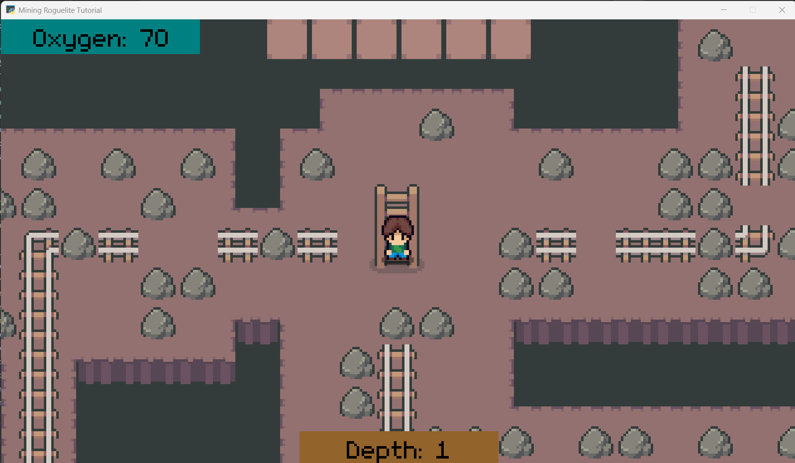
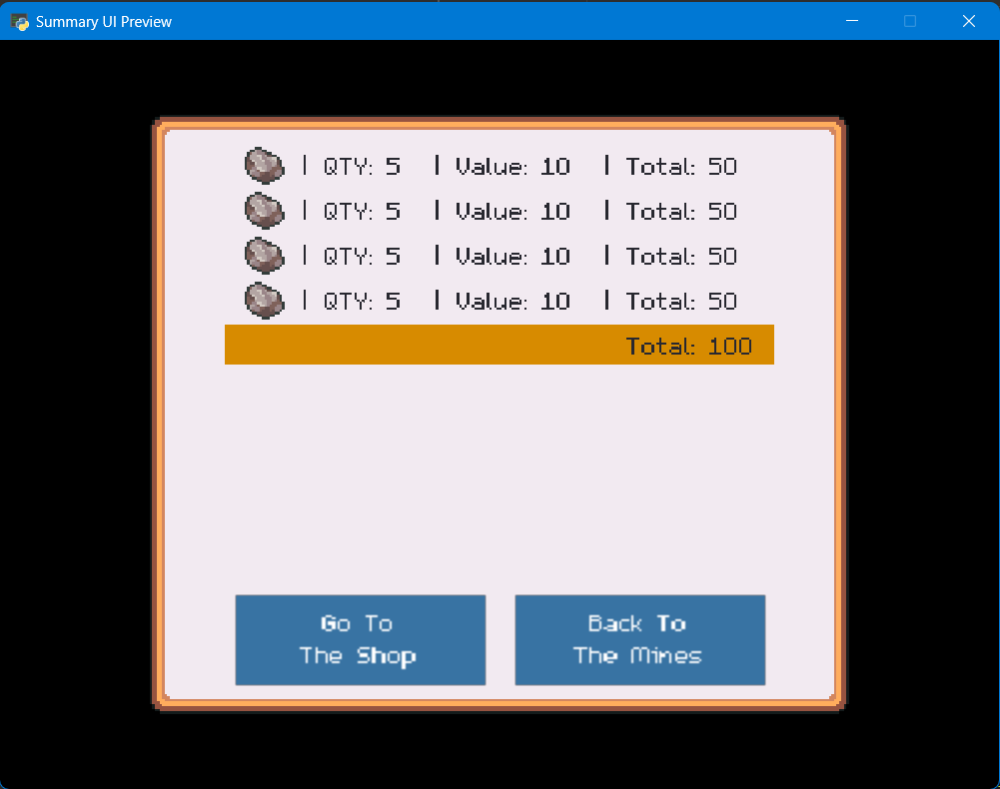
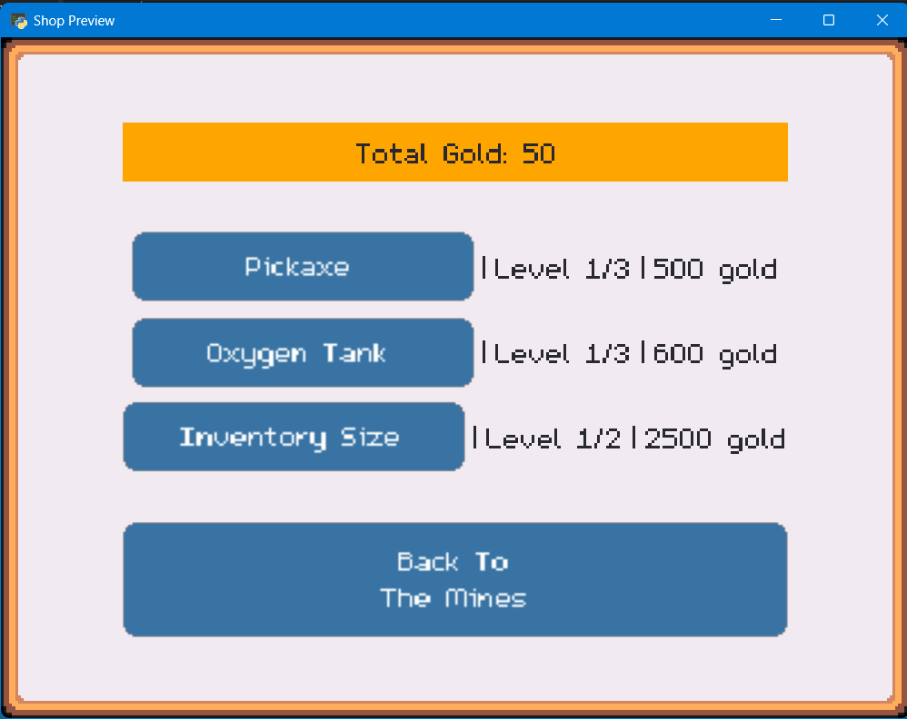

# Mining Roguelike Tutorial

Tutorial base on Udemy course called [Build a Complete Mining Roguelite in Godot 4](https://www.udemy.com/course/godot-mining-roguelite/?couponCode=KEEPLEARNING) by Coding With Russ. I ported the tutorial to Python Arcade to learn coding and game development with some help from AI. I was surprised to see that Arcade can handle this level of game development.

This tutorial is a top-down mining game with procedurally generated rocks and random level maps. It includes a shop where the user can "purchase" a couple of upgrades. Note that the players time below ground is limited by the oxygen level.

Mine Level 1

Inventory Summary Window

Shop Window

See the Mining Roguelike Tutorial Vault for my development logs written in Obsidian markdown.
